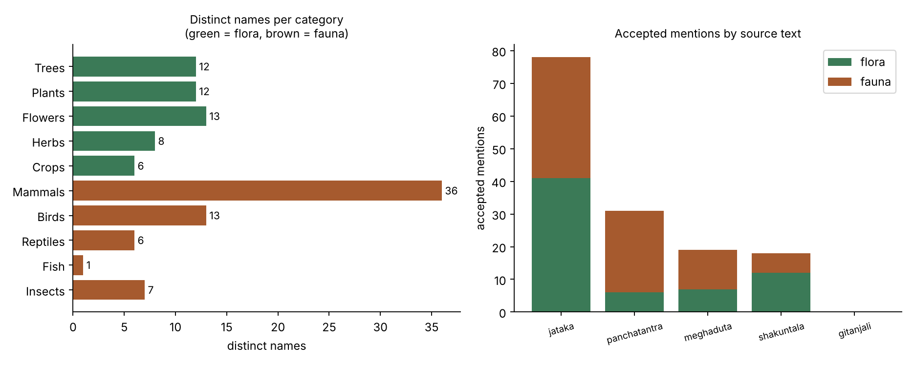
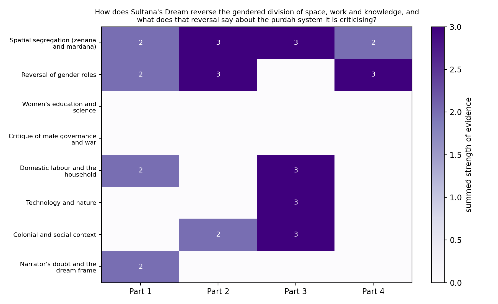
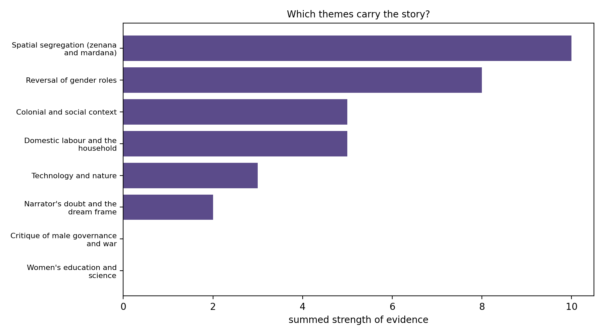

# Digital Humanities Portfolio

**Siddhi Rashi** · MA in DH · Department of HSS · IIT (ISM) Dhanbad · Session 2026-27

A single-page exhibition of my four Digital Humanities assignments for the Monsoon Semester 2026. Each assignment is shown on the page with its abstract, its output, and a button to its own GitHub repository.

**Live site:** `https://dhlab.vercel.app`

## The four assignments

| # | Assignment | What it does | Repository |
|---|---|---|---|
| 1 | Hindi stop words | A list of 24 Hindi stop words in Devanagari, grouped by grammatical role, with a helper that removes them from a sentence | [Project_1_Hindi_Stopwords](https://github.com/siddhirashi/Project_1_Hindi_Stopwords) |
| 2 | Flora and fauna with RAG | A retrieval-augmented generation pipeline over five Indian classics that extracts 50 flora and 63 fauna names, each checked against its source passage | [Project_2_Rag_flora_Fauna](https://github.com/siddhirashi/Project_2_Rag_flora_Fauna) |
| 3 | Synthetic reading | A seven-step synthetic reading of Rokeya Sakhawat Hossain's "Sultana's Dream" with a local LLM, charts of the evidence and an interpretation through feminist theory | [Project_3_Synthetic_Reading](https://github.com/siddhirashi/Project_3_Synthetic_Reading) |
| 4 | LLM skill | A Markdown skill that guides a student from a partial reading to a research problem, a theory and an extraction prompt | [Project_4_LLM_Skill](https://github.com/siddhirashi/Project_4_LLM_Skill) |

## The thread across the projects

In all four, the model finds and sorts, a script checks, and I interpret. The checks mattered: in assignment 2 the model sometimes filed an elephant under reptiles, and in assignment 3, 7 of its 20 quotations did not match the story word for word. The portfolio reflection on the page explains what that taught me.

## What is in this repository

```
index.html     the whole exhibition (one self-contained page)
images/        figures used on the page
README.md      this file
```

### Figures on the page

**Assignment 2: distinct names per category (left) and accepted mentions per source text (right)**



**Assignment 3: strength of evidence for each theme in each quarter of "Sultana's Dream"**



**Assignment 3: total evidence per theme over the whole story**



The charts were made by me from my own results, using matplotlib.

## Tools and models

- Python and matplotlib for the scripts and charts
- LM Studio running local models: `qwen2.5-7b-instruct` for extraction and `nomic-embed-text-v1.5` for embeddings (temperature 0)
- HTML and CSS only for the page, with no build step

## Sources

All texts used are public-domain: Hossain's "Sultana's Dream" (1905); Kalidasa's *Shakuntala* and *Meghaduta*; Tagore's *Gitanjali*; the *Panchatantra*; the *Jataka*. Full citations, including the theory used in assignment 3 (Harding, Hartsock, Massey), are in the "Sources and acknowledgements" section of the page.

## Publishing with GitHub Pages

1. Put `index.html`, `images/` and this README at the top level of a public repository.
2. Open Settings → Pages.
3. Under Build and deployment choose Deploy from a branch, select `main` and `/ (root)`, then Save.
4. After a few minutes copy the site address shown on that page.

## Checks before submitting

- [ ] Every "View this project's GitHub repository" button opens the right project
- [ ] The file links under each assignment open (they assume the branch is `main`)
- [ ] All three images show on the deployed site
- [ ] Each project repository has its own README with images showing
- [ ] No private information or material I do not have permission to share
